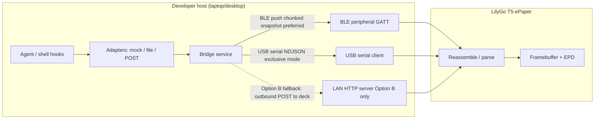
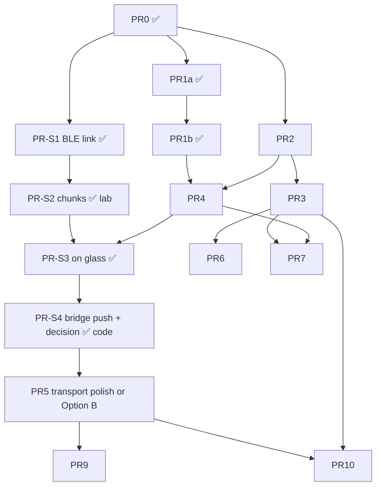

# Agent Control Deck — MVP Product & System Design (Read-Only Status Display)

| Field | Value |
|-------|--------|
| **Document** | Product Design / System Design — MVP |
| **Author** | TBD |
| **Date** | 2026-07-20 |
| **Status** | Draft (rev 2.6 — S1/S2 lab pass incl. house walk-around 100/100; S3/S4 lab + matrix next) |
| **Scope** | Read-only agent status on LilyGo T5-ePaper |
| **Repo** | `agent-control-deck` (this monorepo) |

---

## Overview

**Agent Control Deck** is a desk- and room-portable **e-paper status display** for AI coding agents. Despite the product name, the MVP is a **status deck only**: a **read-only** glanceable view of agent state (name, task summary, running/idle/error, progress, last update) so a developer can leave their phone in their pocket while agents run on a host machine. **Control features (kill, approve, inject prompt, or any intervention) are a future product generation, not a hidden MVP toggle.**

Today the monorepo is under git with a **flashable BLE status spike**: `display_*` helpers, `DeckView` multi-session layout, **NimBLE peripheral** (advertise `ACD-*`, chunked ≤8 KiB StatusSnapshot reassembly + CRC, HEARTBEAT/STATE notify), ArduinoJson parse → on-glass redraw, and **STALE after 30 s** without a successful push — on a **LilyGo T5-ePaper** (classic ESP32-WROVER, 960×540, 4-bit grayscale). Host tools live under **`tools/ble_link/`** (`connect_soak`, `push_xfer`, `mock_bridge`). There is still no formal schema package (PR2), no production bridge package, and no agent adapters. This document defines the product problem, the end-to-end architecture, and an ordered PR plan.

**Transport decision (rev 2.2+):** host machines may be **firewalled against inbound TCP**; SoftAP is **not viable**; third-host status is a **compliance risk**. **PR-S1…PR-S4 code is landed** — fill the [decision matrix](#ble-transport-spike) / [`docs/ble-spike.md`](ble-spike.md) from lab soaks before Option B or host-as-server work. USB serial remains the desk/debug exclusive-mode path. Control/intervention is **explicitly out of scope**.

---

## Background & Motivation

### Current state of the codebase

| Path | What exists |
|------|-------------|
| [`.gitignore`](../.gitignore) | Root hygiene: `.pio/`, secrets, venvs, `.env*`, OS/IDE junk (**PR0**) |
| [`README.md`](../README.md) | Monorepo map; points at `deck/`, `docs/ble-spike.md`, `tools/ble_link/` |
| [`deck/`](../deck/) | PlatformIO firmware project |
| [`deck/platformio.ini`](../deck/platformio.ini) | Env `T5-ePaper`, `espressif32@6.12.0`, Arduino, `BOARD_HAS_PSRAM`; LilyGo-EPD47 + **NimBLE** + **ArduinoJson ^7** |
| [`deck/boards/T5-ePaper.json`](../deck/boards/T5-ePaper.json) | Board def: ESP32, 16MB flash, WiFi+BT, max RAM 327680 (+ external PSRAM); sets `ARDUINO_USB_MODE=1` (board-family template; classic T5 uses external USB-UART as deck README states) |
| [`deck/src/display.h`](../deck/src/display.h) / [`display.cpp`](../deck/src/display.cpp) | `display_init` / framebuffer / `display_present` (**PR1a**) |
| [`deck/src/status_model.h`](../deck/src/status_model.h) | C-only `DeckView` / session row structs (**PR1b**) |
| [`deck/src/status_parse.h`](../deck/src/status_parse.h) / [`status_parse.cpp`](../deck/src/status_parse.cpp) | StatusSnapshot JSON → `DeckView` content (**PR-S3**) |
| [`deck/src/ui_layout.h`](../deck/src/ui_layout.h) / [`ui_layout.cpp`](../deck/src/ui_layout.cpp) | Header + ≤3 rows + footer; ASCII tokens; geometric progress bars; SCHEMA/STALE/empty frames (**PR1b**) |
| [`deck/src/ble_gatt.h`](../deck/src/ble_gatt.h) / [`ble_gatt.cpp`](../deck/src/ble_gatt.cpp) | NimBLE: `ACD-*` adv, HEARTBEAT/INFO, CTRL/DATA reassembly + CRC, STATE notify (**PR-S1/S2**) |
| [`deck/src/main.cpp`](../deck/src/main.cpp) | Wi‑Fi off → poll → parse → present; fail_count + **30 s STALE grace** (**PR-S3/S4**) |
| [`tools/ble_link/`](../tools/ble_link/) | `connect_soak.py` (S1), `push_xfer.py` (S2), `mock_bridge.py` (S3/S4), `protocol.py`, sample payloads |
| [`docs/ble-spike.md`](ble-spike.md) | UUIDs, wire format, phase checklist, decision matrix log |

**Done so far:** **PR0**, **PR1a**, **PR1b**, **PR-S1** (lab link), **PR-S2** (lab **100/100** bulk transfer, including house walk-around), **PR-S3/S4** code landed — complete remaining checklists in `docs/ble-spike.md`.

**What does not exist yet:** formal schema package (PR2), production `bridge/` package, USB product path, Option B WiFi, config storage, agent adapters, filled decision matrix.

### Hardware facts (honest)

| Item | Value |
|------|--------|
| Board | LilyGo T5-ePaper (classic **ESP32-WROVER**, not S3) |
| Panel | 4.7", **960×540**, 4-bit grayscale (packed 2 pixels/byte) |
| Framebuffer | `EPD_WIDTH * EPD_HEIGHT / 2` = **259,200 bytes** in PSRAM (`ps_calloc`) |
| Display API | LilyGo-EPD47 / epdiy: `epd_init`, `epd_poweron/off`, `epd_clear`, `epd_clear_area`, `epd_draw_grayscale_image`, `epd_fill_rect`, `writeln` + FiraSans |
| Connectivity | WiFi + Bluetooth (board JSON); USB for flash/serial (~460800 upload, 115200 monitor on UART0) |
| Buttons (classic ESP32) | `BUTTON_1=34`, `BUTTON_2=35`, `BUTTON_3=39` ([`utilities.h`](https://github.com/Xinyuan-LilyGO/LilyGo-EPD47/blob/master/src/utilities.h) in sibling LilyGo-EPD47) |
| Battery sense | `BATT_PIN=36` (ADC). LilyGo `demo.ino`: **must `epd_poweron()` (POWER_EN) before `analogRead(BATT_PIN)`**. Treat battery UI as **off by default** until validated on the physical revision |
| Full refresh | Multi-second flash class (~1–3 s typical; **measure on hardware**); design for infrequent full updates |
| Deep sleep | Supported (LilyGo `examples/sleep`); `epd_poweroff_all` + timer wake |
| Classic ESP32 caveat | LilyGo notes that **not all examples fully work** on classic ESP32 env; soak-test WiFi + PSRAM framebuffer together |

### Pain points the product addresses

1. **Phone-pull tax**: Checking whether a long agent run finished requires unlocking a phone or switching desktop focus.
2. **Ambient awareness**: Agent work is background; status belongs on a low-power always-visible surface, not a glowing LCD.
3. **Portable glance**: User may carry the **deck** to another room while the **host stays on the desk** (same SSID / stable host IP). WiFi status follows the deck without carrying a laptop screen.
4. **E-paper fit**: Infrequent updates and high contrast text match agent state changes (minutes, not milliseconds).

### Persona

**Primary:** Solo or small-team developer running local AI coding agents (Claude Code, Codex CLI, Cursor agent mode, Aider, custom scripts) on a workstation or laptop on the same LAN (or USB-tethered).

**Secondary (deferred UX):** Multi-machine / cloud agent sessions — data model should not forbid them, but MVP integration is **file/POST hooks on one host**, not cloud multi-tenant.

---

## Goals & Non-Goals

### Goals (MVP)

1. **Glanceable status**: From ~1–2 m, user can tell: is anything running? which agent? what task? healthy or error?
2. **Read-only status deck only**: Display status; no send, kill, approve, or interactive control. Control is a later generation.
3. **Desk + room use**: USB-powered desk mode works; WiFi enables untethered room-to-room glance of the **deck** while host remains on a **stable LAN IP** (same SSID).
4. **Host bridge**: A small host-side process collects/normalizes agent status and serves it to the deck.
5. **Stable status model**: Versioned JSON schema for agents/sessions that firmware and host share.
6. **Honest offline UX**: Clear “disconnected / stale” presentation when host unreachable (including host sleep / IP change).
7. **Incremental delivery**: Mergeable PRs from hello-world → layout → mock status → WiFi → bridge → file/POST integration.
8. **Power-aware refresh**: Panel powered only during draw; poll interval suitable for e-paper (tens of seconds).

### Non-Goals (MVP)

| Non-goal | Rationale |
|----------|-----------|
| Agent control (stop, approve, inject prompt) | Explicit product constraint; future generation, not MVP toggle |
| Multi-page dashboards / touch UI | Buttons exist; paging deferred; touch not required |
| Cloud SaaS / accounts / multi-user auth | Local-only trust model |
| Perfect partial-refresh ghost-free UI | Full-frame strategy is enough for MVP |
| First-party adapter for every agent CLI | **Supported MVP integration = file/POST hooks**; named agent scrapers deferred |
| SoftAP on the deck (host joins device AP) | Host must keep its normal Wi‑Fi for agents/internet |
| Host TCP status server when inbound is firewalled | Product constraint: cannot rely on opening host listen ports |
| Third-party / off-box status relay | Compliance risk for agent/task text that may contain secrets |
| Mobile app companion | Phone is what we’re avoiding |
| mDNS host discovery | Deferred unless a future LAN transport needs it |
| SNTP / wall clock on device | Deferred; relative `millis()` age only |
| Beautiful multi-font graphic design | Functional FiraSans + ASCII tokens first |
| Classic ESP32 Wi‑Fi + BLE concurrent radios in first spike | Avoid coexistence complexity; BLE spike is BLE-only |

### Success metrics

| Metric | Target (MVP) |
|--------|----------------|
| Time to first meaningful status after boot (desk, transport linked) | &lt; 30 s |
| Status freshness when connected | ≤ poll interval + 5 s (default poll **15 s**) + draw time |
| User glance comprehension | Identify “running vs idle vs error” in &lt; 2 s without reading body text |
| Disconnected clarity | “STALE” / “NO LINK” visible when **`fail_count >= 2`** (i.e. after **two consecutive failed polls**, ~**30 s** at 15 s poll) — see [Offline policy](#offline--disconnected-behavior) |
| Full-screen refresh rate | ≤ **2 full flashes/minute** under steady state (change-driven only; no 60 s heartbeat redraw) |
| Host bridge idle CPU | Negligible (&lt; 1% on laptop when no agents) |
| Firmware crash rate | No watchdog resets during 8 h continuous poll test (PR5 acceptance + soak checklist) |

### Product assumptions (portable story)

**Provisional** until the [BLE transport spike](#ble-transport-spike) completes. Two portable models are in play:

**A. BLE-primary (preferred if spike passes)**

1. **Host keeps its normal Wi‑Fi** (agents/internet). Deck does **not** require SoftAP.
2. **Host does not open inbound TCP** for status. Bridge is a **BLE central** that pushes snapshots.
3. **Portable = deck moves within BLE range** of the host; host stays on the desk. Out of range / host sleep → **STALE is expected**.
4. Status RF stays host↔deck (not corporate LAN / third host) — preferred compliance posture.

**B. LAN reverse-push “Option B” (fallback if BLE fails range/reliability)**

1. Deck joins the same SSID as STA and **listens**; host **outbound-only** POSTs snapshots (host still does not need an inbound port).
2. Requires accepting agent/task text on the LAN; not SoftAP; not a third-party relay.
3. Stable deck addressing (DHCP reservation or documented discovery) becomes a product assumption again.

**Shared**

- Desk tethered path: **USB NDJSON** exclusive mode (no radio).
- Host-as-server device-pull (`GET` host:8787) is **not** a reliable product assumption under host firewall policy.
- mDNS / captive portal / NVS config UI remain post-spike unless Option B needs minimal discovery.

---

## Proposed Design

### System architecture

Three logical components:

1. **Deck firmware** (`deck/`) — ESP32: receive status snapshot (BLE, USB, and/or future LAN push), render e-paper, wait, repeat.
2. **Host bridge** (`bridge/` — new) — process on the developer machine: collect agent status, **push** snapshot to the deck (BLE central and/or USB writer; LAN reverse-push only if Option B is selected). Optional localhost HTTP is for tools/adapters only, not for the firewalled “serve the deck” path.
3. **Agent adapters** (`bridge/adapters/` — new) — pluggable sources. MVP ships **Mock**, **file**, and **POST** (loopback-only writes for local hooks). Named agent scrapers are **deferred**; file/POST hooks are the supported integration.



### Why host bridge (not agents talking to the device directly)

- Agents have heterogeneous APIs (files, sockets, none).
- Device stays dumb and low-power: one schema, one receive path.
- Security boundary is the host process (+ short-range RF or USB), not every agent binary holding device credentials.
- Easier mock/demo without real agents; **file/POST (localhost) is the supported human integration** into the bridge; the bridge then **pushes** to the deck.

### Transport strategy

| Path | Role | Status |
|------|------|--------|
| **BLE host-push (preferred portable)** | Deck = GATT peripheral; host bridge = BLE central; chunked `StatusSnapshot` write | **Spike first** — see [BLE transport spike](#ble-transport-spike) |
| **USB serial (desk/debug, exclusive mode)** | Host writes NDJSON snapshots; device reads UART0 | Planned secondary; not concurrent with radio modes |
| **LAN reverse-push “Option B”** | Deck STA + listen; host **outbound** POST only | **Fallback** if BLE fails range/OS reliability; accepts LAN exposure of summaries |
| SoftAP on deck | Host joins device AP | **Rejected** — host must keep normal Wi‑Fi |
| Device-pull WiFi (`GET` host bridge) | Deck HTTP client → host listen port | **Rejected as product primary** — host inbound may be firewalled closed with no reopen |
| Third-party network relay | Host → middlebox → deck | **Rejected** — compliance risk for agent/task text |

**Direction of data:** always **host → device** for MVP (read-only). Device never sends control commands. Prefer **host-as-client** transports (BLE central, USB writer, or outbound HTTP) so the firewalled host never needs an inbound TCP port.

**Provisional sequence (BLE-primary target):**

```mermaid
sequenceDiagram
  participant Agent
  participant Adapter
  participant Bridge
  participant Deck

  Note over Deck: Advertise GATT status service
  Bridge->>Deck: BLE connect + optional pair
  loop On change or heartbeat interval
    Adapter->>Agent: Observe (file / mock / post store)
    Adapter->>Bridge: Update owned session set
    Bridge->>Deck: Chunked write StatusSnapshot
    alt schema_version == 1 and assemble OK
      Deck->>Deck: Clear fault; redraw if content changed
      Deck-->>Bridge: notify ok optional
    else schema unsupported
      Deck->>Deck: fault=schema; SCHEMA frame
    else link loss / incomplete transfer
      Deck->>Deck: fail_count++; STALE if grace exceeded
    end
  end
```

Historical note: rev 2.1 described device-pull WiFi via LilyGo `ha_calendar` (`HTTPClient` GET). That remains a useful **engineering reference for JSON + EPD**, but **not** the product transport under current host firewall + SoftAP constraints.

### BLE transport spike

**Goal:** Validate whether BLE can be the **primary portable** path before investing in Option B (LAN reverse-push). SoftAP is out of scope for this spike.

**Why this spike exists**

| Constraint | Implication |
|------------|-------------|
| Host may be firewalled with **no inbound TCP** | Host must not be the HTTP status server |
| Host **must keep normal Wi‑Fi** for agents | SoftAP (host joins deck AP) is not viable |
| Agent/task text may be sensitive | Prefer not to place summaries on corp LAN or a third host |
| Portable glance without phone | Need RF that does not steal host Wi‑Fi |

**Roles (fixed for the spike)**

- **Deck** = BLE **peripheral** (GATT server), advertises a fixed service UUID.
- **Host bridge** = BLE **central** (client) via Python **`bleak`** (macOS/Linux/Windows).
- **Wi‑Fi on the deck is off** for the spike (no SoftAP, no STA, no Wi‑Fi+BLE coexistence).
- **Payload** = existing `StatusSnapshot` v1 JSON (≤ 8 KiB); BLE only adds a thin chunk envelope.

**GATT sketch (spike-quality; UUIDs fixed in PR-S1 — see [`docs/ble-spike.md`](ble-spike.md))**

Base: `a0cd****-acd0-4c00-9c00-00805f9b34fb`. Device name: `ACD-` + last 4 hex of BT MAC.

| Char | UUID suffix | Properties | Purpose | Status |
|------|-------------|------------|---------|--------|
| Service | `0001` | — | Status service | **Done** |
| `HEARTBEAT` | `0002` | read + notify | Link liveness (~5 s when subscribed) | **Done** |
| `INFO` | `0003` | read | FW version, max payload, preferred MTU, name | **Done** |
| `STATUS_CTRL` | `0010` | write | binary BEGIN/ABORT/COMMIT + len/CRC | **Done** (S2) |
| `STATUS_DATA` | `0011` | write / write-without-response | `seq u16 LE` + payload slice | **Done** (S2) |
| `STATUS_STATE` | `0012` | notify | Deck ack: `ok` \| `schema` \| `overflow` \| `busy` \| `bad_crc` \| … | **Done** (S2) |

**Host push flow**

1. Scan/connect to bonded or name-filtered deck (`ACD-…`).
2. Request MTU; fall back to conservative chunk size if negotiation is weak.
3. `CTRL begin` → stream `STATUS_DATA` chunks → `CTRL commit`.
4. Wait for notify (or timeout → treat as transport failure).
5. Repeat on session-set change and/or heartbeat (e.g. 15 s), matching e-paper cadence.

**Offline / fault mapping (reuse PD policy)**

| Condition | Device behavior |
|-----------|-----------------|
| No connection / no successful commit for grace window | `fail_count` path → **STALE** with cached frame |
| Unsupported `schema_version` after full reassembly | **SCHEMA** frame; does **not** increment transport `fail_count` (same precedence as Outcomes A/B/C) |
| Incomplete transfer / overflow | Transport failure (Outcome C class) |
| Successful v1 commit | Clear fault; age from `millis()` at last ok |

**Spike phases and exit criteria**

| Phase | Work | Pass criteria | Status |
|-------|------|----------------|--------|
| **S1 — Link** | NimBLE peripheral on deck; advertise; accept one connection; notify heartbeat | Host `bleak` script stays connected **≥ 30 min**; reconnect after host BT toggle works | **Done** (PR-S1, lab) |
| **S2 — Bulk transfer** | Chunked 2–8 KiB write + reassembly + CRC/len check | **100 consecutive** full transfers with zero corruption; log negotiated MTU + duration | **Lab pass** (100/100; house walk-around OK) |
| **S3 — On glass** | Reassembled snapshot → parse → e-paper status layout | Mock **3 sessions** visible; change on host → screen updates within one heartbeat + draw | **Code done** — run `mock_bridge.py` |
| **S4 — Bridge-shaped** | Tiny bridge: mock → bleak push; STALE when pusher killed | Kill pusher → STALE within grace (30 s); restart → recovery redraw; free heap stable across 30 min | **Code done** — fill decision matrix |

**S4 is the product gate**, not S1. A stable phone nRF Connect session is necessary but not sufficient.

**Explicit non-goals of the spike**

- Production pairing UX polish (PIN on glass, multi-device).
- Wi‑Fi+BLE coexistence or Option B implementation.
- Full bridge HTTP surface, scrapers, or USB mode (USB can remain a parallel desk path later).
- Background launchd/plist hardening on macOS (foreground user-session bridge is enough).

**Risks to measure (not design away in docs)**

| Risk | How the spike answers it |
|------|---------------------------|
| Classic ESP32 RAM vs PSRAM FB + NimBLE | Heap log each transfer; crash/WDT = fail |
| macOS Bluetooth permissions / sleep | Document required TCC prompts; lid-sleep behavior |
| Indoor range (“other room”) | Walk test with walls; record usable distance |
| Reconnect flaps | Count disconnects in 30 min soak |
| Spoofed writers nearby | Note whether unauthenticated writes are acceptable for lab only; list bonding as follow-up |

**Decision matrix after S4**

| Result | Next step |
|--------|-----------|
| S4 pass + acceptable room range | **Lock BLE as primary portable transport**; rewrite PR critical path around BLE push; keep USB desk path; Option B deferred |
| S4 pass but range too short for real use | Keep BLE for near-desk; **start Option B design** for whole-floor portable |
| S1–S2 fail (stack/RAM/OS) | Stop BLE primary; go **Option B** (deck STA listen + host outbound POST); USB remains desk path |
| Host still cannot talk BLE in user env | USB-only desk MVP until a viable RF path exists |

**Implementation notes**

- Prefer **NimBLE** (`h2zero/NimBLE-Arduino` or ESP-IDF NimBLE) over Bluedroid for RAM.
- Cap reassembly buffer at **8 KiB** (same as prior HTTP budget).
- Default logs: connect state, MTU, bytes, latency, heap — **never** summary body text.
- LilyGo-EPD47 has **no** first-party BLE status example; treat as greenfield on top of existing EPD hello-world.

**Spike PR slice (see PR Plan)** — `PR-S0` docs already this section; `PR-S1`…`PR-S4` implement phases. Do **not** start legacy WiFi device-pull PRs (old PR5) until this decision matrix is applied.

### Status data model

Versioned snapshot. Host is source of truth; device is a renderer.

```json
{
  "schema_version": 1,
  "generated_at": "2026-07-20T18:42:01Z",
  "host": {
    "name": "brandon-mbp",
    "bridge_version": "0.1.0"
  },
  "sessions": [
    {
      "id": "mock:demo-1",
      "agent": "mock",
      "title": "agent-control-deck",
      "summary": "Implement WiFi poll + status layout",
      "state": "running",
      "progress": 0.45,
      "detail": "Editing deck/src/ui_layout.cpp",
      "started_at": "2026-07-20T18:10:00Z",
      "updated_at": "2026-07-20T18:41:58Z",
      "error": null
    },
    {
      "id": "file:docs",
      "agent": "other",
      "title": "docs",
      "summary": "Idle",
      "state": "idle",
      "progress": null,
      "detail": null,
      "started_at": null,
      "updated_at": "2026-07-20T17:00:00Z",
      "error": null
    }
  ]
}
```

Note: `link.transport` is **not** a wire field from the bridge. Transport is **device-local** (which path fetched the snapshot). Removed from schema v1 wire format to avoid implying the host knows the device transport.

#### Field dictionary (schema v1 — source of truth)

| Field | Required | Type | Max / constraints | Notes |
|-------|----------|------|-------------------|--------|
| `schema_version` | yes | int | MVP = `1` | Firmware rejects unsupported major; see [HTTP error contract](#http-api-error-contract) |
| `generated_at` | yes | string | ISO-8601 UTC | Host clock; **host-side debug / future SNTP only** — device does **not** use it for UI age or STALE |
| `host` | yes | object | — | Host metadata |
| `host.name` | yes | string | ≤ 32 chars | Footer label |
| `host.bridge_version` | yes | string | ≤ 16 chars | Footer / debug |
| `sessions` | yes | array | 0..N after sort; bridge **truncates to top 3** for default snapshot | Global sort at snapshot build |
| `sessions[].id` | yes | string | ≤ 64 chars; unique in snapshot | Prefer `adapter_name:local_id` to avoid collisions |
| `sessions[].agent` | yes | string | ≤ 24 chars | `claude-code` \| `codex` \| `cursor` \| `aider` \| `mock` \| `other` (open string ok; unknown → display as-is truncated) |
| `sessions[].title` | yes | string | ≤ 24 chars ideal (device truncates) | Project / workspace short name |
| `sessions[].summary` | yes | string | ≤ 80 chars ideal (device truncates) | One-line task; **ASCII recommended** |
| `sessions[].state` | yes | enum | — | `running` \| `idle` \| `waiting` \| `error` \| `done` \| `unknown` |
| `sessions[].progress` | no | number or null | 0.0–1.0 | Omit or null if unknown; bar only if non-null |
| `sessions[].detail` | no | string or null | ≤ 80 chars | Secondary line |
| `sessions[].started_at` | no | string or null | ISO-8601 | Optional; **device ignores for MVP UI** |
| `sessions[].updated_at` | yes | string | ISO-8601 | Per-session host freshness; device may ignore for age display |
| `sessions[].error` | no | string or null | ≤ 80 chars | Prefer set when `state=error` |

**Sort key (bridge, at snapshot build):**

1. State priority: `error` (0) → `running` (1) → `waiting` (2) → `unknown` (3) → `idle` (4) → `done` (5)
2. Tie-break: newer `updated_at` first
3. Tie-break: `id` ascending

**Truncation (frozen for MVP):**

- Bridge default: emit at most **`display_limit = 3`** sessions after sort (configurable higher only for debug dumps, not for deck WiFi path).
- Device hard-cap: **exactly 3 rows** max; if a non-truncated payload somehow has more, show 3 and footer `+N more` using `sessions_total` if present — for v1, bridge should include optional `sessions_total` (int, optional) when truncating. **Add optional field:**

| Field | Required | Type | Notes |
|-------|----------|------|--------|
| `sessions_total` | no | int | Total sessions before truncation; enables footer `+N more` |

**Payload budget:** entire JSON body **≤ 8 KiB**. Device aborts if `Content-Length` or accumulated body exceeds 8 KiB.

#### Device-local view model

Firmware maps snapshot → `DeckView` (never trusts host wall clock):

| Field | Source |
|-------|--------|
| `link_state` | `ok` if last fetch was a **valid v1 success**; else `degraded` / `down` from transport `fail_count` (see offline policy). Does not alone choose the full-screen frame when `fault == schema` |
| `stale` | Transport-connectivity flag: `true` when `fail_count >= 2` from **transport/parse failures only**. **Does not drive the frame when `fault == schema`** |
| `fault` | `none` \| `schema`. Schema mismatch is a dedicated fault; not silent STALE |
| `age_ms` | `millis() - last_ok_ms` after a successful **v1** fetch; shown as coarse relative text on normal/STALE frames only |
| `rows[]` | **0–3** sessions; strings truncated; **ASCII state tokens** (unused while SCHEMA frame is active) |
| `footer` | `host.name`, `bridge_version`, coarse age (`12s` / `3m`), battery `--` unless enabled |
| `transport` | device-local: `wifi` or `usb` |
| `last_http_code` / `last_error` | for NO LINK / SCHEMA detail lines |
| `last_schema_version` | optional int from last body, for SCHEMA message |

**Full-screen frame priority (highest wins):**

1. **`fault == schema` → SCHEMA frame** (always, for as long as the last successful *parse path* concluded unsupported schema — including repeated schema responses). STALE banner and cached session rows are **not** shown.
2. Else if **`fail_count >= 2`** → STALE / NO LINK frame (may show cached sessions under banner).
3. Else if **valid cached/current snapshot** → normal status layout (`link_state` may be `degraded` after one transport fail without forced STALE frame).
4. Else (boot, never succeeded) → connecting / NO LINK empty frame.

### E-paper UI (wireframe)

Panel: **960×540**. Layout uses margins ~20–24 px, FiraSans from LilyGo-EPD47 (same as hello-world).

**ASCII-only state tokens (MVP mandate):** `*` running, `o` idle, `...` waiting, `!` error, `v` done, `?` unknown. Progress is drawn with **`epd_fill_rect` / `epd_draw_rect`**, not block Unicode characters.

```
+--------------------------------------------------------------------------+
|  AGENT CONTROL DECK                              WiFi *  12s  bat --%    |  header ~48px
+--------------------------------------------------------------------------+
|  * RUNNING   mock · agent-control-deck                                   |  row 0 ~110px
|  Implement WiFi poll + status layout                                     |
|  [##########----------] 45%   Editing deck/src/ui_layout.cpp             |
+--------------------------------------------------------------------------+
|  o IDLE      other · docs                                                |  row 1
|  No active task                                                          |
+--------------------------------------------------------------------------+
|  ! ERROR     mock · demo                                                 |  row 2
|  Adapter crash: permission denied /tmp/agent.log                         |
+--------------------------------------------------------------------------+
|  host:brandon-mbp   bridge 0.1.0   schema v1   refresh #14               |  footer ~36px
+--------------------------------------------------------------------------+
```

**Empty / no agents:**

```
|           No agent sessions                                              |
|           Bridge OK · waiting for adapters                               |
```

**Disconnected (STALE):**

```
|           NO LINK                                                        |
|           Last ok 3m ago · http://192.168.1.20:8787/v1/status            |
|           err=timeout  Showing cached snapshot (STALE)                   |
```

**Schema fault:**

```
|           SCHEMA                                                         |
|           Unsupported schema_version (got N, need 1)                     |
|           Update bridge or firmware                                      |
```

**Layout rules**

- **Max 3 sessions** on screen (matches bridge default truncation).
- If `sessions_total > 3`, footer shows `+N more` where `N = sessions_total - 3`.
- **Grayscale**: black text on white (0x00 on 0xFF buffer, matching hello-world).
- **No animation**. Redraw only on content change, link/fault transition, or periodic full clear — not to tick “seconds ago”.

### Firmware architecture (`deck/`)

Evolve from single `main.cpp` into modules (still Arduino/PlatformIO). Networking structure can be adapted from LilyGo **`examples/ha_calendar/`** rather than invented greenfield.

```
deck/
  src/
    main.cpp              # Wi‑Fi off + demo draw + ble_gatt_poll (PR-S1)
    config.h / config.cpp # transport mode flags, intervals (later)
    ble_gatt.cpp / .h     # NimBLE peripheral — link done (S1); + chunk reassembly (S2)
    protocol_usb.cpp      # exclusive-mode serial snapshot reader
    net_wifi.cpp          # Option B only: STA + listen (deferred)
    protocol_http.cpp     # Option B only: accept host outbound POST (deferred)
    status_model.h/.cpp   # structs (S1) + parse ArduinoJson v7 (S3)
    ui_layout.cpp         # draw header/rows/footer into framebuffer (PR1b ✅)
    display.cpp           # epd power, clear, present (PR1a ✅)
    power.cpp             # light/deep sleep later
  secrets.h.example       # gitignored secrets if any WiFi path returns
  platformio.ini          # NimBLE ✅; + bblanchon/ArduinoJson@^7 in S3
  boards/T5-ePaper.json

tools/ble_link/           # PR-S1 host soak (bleak); S2+ chunk pusher grows here or under bridge/
docs/ble-spike.md         # UUIDs + phase log + decision matrix
```

**Main loop sketch (BLE peripheral / continuous desk mode):**

```cpp
// Conceptual — not production code
void loop() {
    // BLE: progress reassembly / connection state (or USB exclusive reader)
    FetchResult fr = poll_transport(&snap);  // commit complete → success; else idle/fail
    apply_fetch_result(fr);                  // updates fail_count, last_ok_ms, fault

    if (should_redraw()) {
        render_to_framebuffer(framebuffer, deck_view);
        epd_poweron();
        // full-frame present: ~1–3s class; measure on HW
        if (need_full_clear) epd_clear();  // every N successful draws (e.g. 30)
        epd_draw_grayscale_image(epd_full_screen(), framebuffer);
        epd_poweroff();
    }
    delay(LOOP_IDLE_MS);  // BLE is event-driven; avoid tight spin
}
```

**Redraw policy**

| Condition | Action |
|-----------|--------|
| First successful snapshot | Full clear + draw |
| Session content change (id/state/summary/progress/title/detail/error set) | Full draw |
| `link_state` or `fault` transition (incl. enter/exit STALE, SCHEMA) | Full draw |
| Heartbeat-only age tick | **No redraw** (e-paper cannot show live ticking seconds usefully; age text updates on next content/fault draw) |
| Every N full draws (e.g. 30) | Force `epd_clear()` before present to reduce residual image |
| HTTP poll during draw | Sequential: poll then draw; poll is not concurrent with EPD transfer |

**Flash budget:** Assume ~1–3 s per full present until measured. At 15 s poll and change-driven redraws, steady-state agents that flip state every poll would exceed comfort — adapters should not flap. Success metric: ≤ 2 full flashes/minute in normal use.

### Offline / disconnected behavior

**Single policy (device-local clocks only).** Classify each fetch into exactly one outcome before updating state:

```
// Outcome A — valid v1 success
// HTTP 200, body ≤ 8 KiB, JSON parse OK, schema_version == 1
fail_count = 0
fault = none
last_ok_ms = millis()
cache snapshot
link_state = ok
// Frame: normal status (priority 3)

// Outcome B — schema unsupported
// Body parsed enough to read schema_version, and schema_version != 1
// (includes JSON that is otherwise well-formed)
fault = schema
last_schema_version = parsed value
// Do NOT increment fail_count (schema is not a transport outage)
// Do NOT set stale = true for UI purposes
// Frame: SCHEMA always (priority 1) — never paint STALE over SCHEMA
// Optional: keep prior cache in RAM but do not render it while fault==schema

// Outcome C — transport / payload failure
// timeout, non-200, oversize, JSON parse error, empty body
fail_count++
// Do NOT set fault = schema (clear schema fault only on Outcome A;
//   if previous fault was schema and we now get Outcome C, keep fault=schema
//   so SCHEMA remains until a good v1 body arrives — user still needs firmware/bridge fix.
//   Exception: if we never entered schema fault, fault stays none.)
if fault == schema:
  Frame: SCHEMA (priority 1)  // still wins; fail_count may rise for logs only
else:
  if fail_count == 1: link_state = degraded; keep prior UI (no forced redraw)
  if fail_count >= 2: link_state = down; stale = true → STALE frame (priority 2)

// Recovery
// First Outcome A clears fault, fail_count, and stale; one full clear + normal draw recommended.

age display: age_ms = millis() - last_ok_ms  (only after at least one Outcome A)
```

**UI precedence summary:** `SCHEMA` > `STALE` > normal. `fail_count` drives STALE **only when `fault != schema`**. Pure schema mismatch **does not** increment `fail_count` (option b). After SCHEMA has been latched, subsequent transport failures leave SCHEMA on screen until a valid v1 snapshot recovers.

Transport STALE still means **two consecutive Outcome C failures** (~30 s at 15 s poll) when not in schema fault — matches success metric.

`generated_at` is **not** used for this decision on device.

### USB serial transport (exclusive mode)

Classic T5 uses external USB-UART on **UART0** at **115200** (same as `monitor_speed`). Status NDJSON and PlatformIO serial monitor **contend for one port**.

**Rules for MVP:**

1. **Exclusive transport modes** via compile flags — never both active:
   - `ACD_TRANSPORT_WIFI=1`, `ACD_TRANSPORT_USB=0` (default)
   - `ACD_TRANSPORT_WIFI=0`, `ACD_TRANSPORT_USB=1`
2. In USB mode, **host serial writer is the only producer of payload lines**. Device **verbose logs must be disabled** or emitted only as lines that **do not start with `{`**. Parser: ignore any line that does not begin with `{` after optional whitespace.
3. Framing: **one StatusSnapshot JSON object per line** (NDJSON), max **8192 bytes** per line including newline. Partial lines buffered until `\n` or overflow → reset buffer, count failure.
4. Host flush cadence: write a full snapshot line at least every poll interval (e.g. 15 s); device may block-read with timeout = `HTTP_TIMEOUT` equivalent (5 s) per attempt and apply same `fail_count` policy.
5. Flash/upload: stop host serial writer before `pio run -t upload`; port cannot be shared.
6. Device does not require a hello message; optional `{"type":"hello",...}` lines are ignored (not starting a full StatusSnapshot with `schema_version`).

### Host bridge architecture (`bridge/` — new package)

**Python 3.11+** for MVP. Primary job: **build snapshots and push** to the deck (BLE central via `bleak`, and/or USB). Optional **localhost HTTP** is only for local hooks/tools — not for serving a firewalled host’s LAN to the deck.

```
bridge/
  pyproject.toml
  README.md
  src/agent_control_deck_bridge/
    __init__.py
    main.py              # CLI: push-ble, push-usb, mock, optional serve-localhost
    model.py             # pydantic StatusSnapshot
    store.py             # per-adapter session sets + lock
    ble_out.py           # bleak central chunked push (spike / primary)
    serial_out.py        # exclusive USB writer
    server.py            # optional localhost HTTP for hooks only
    adapters/
      base.py
      mock.py
      file_adapter.py
  tests/
```

#### Egress (deck-facing)

| Egress | Role | When |
|--------|------|------|
| **BLE push** | Central writes chunked snapshot to deck GATT | Preferred portable path after spike |
| **USB NDJSON** | Write full snapshot lines to serial | Desk/debug exclusive mode |
| **LAN outbound POST** | Host client → deck HTTP | Option B only, post-decision |

#### Optional localhost HTTP (hooks only)

Default bind **`127.0.0.1` only**. This is **not** the “open a port for the deck” design.

| Method | Path | Bind policy | Response |
|--------|------|-------------|----------|
| `GET` | `/healthz` | **loopback only** | `200 {"ok": true}` |
| `GET` | `/v1/status` | **loopback only** | `200` StatusSnapshot JSON (debug) |
| `POST` | `/v1/sessions` | **loopback only** | **Upsert by `id`** into the `post` adapter set |
| `PUT` | `/v1/adapters/post` | **loopback only** | **Replace entire** `post` set |
| `DELETE` | `/v1/sessions/{id}` | **loopback only** | Remove one id from the `post` set only |

- File adapter uses host filesystem only (no network write surface).
- If Option B is later selected, deck-facing HTTP lives **on the deck**, not as a LAN-exposed host GET server.

#### Transport outcome contract (device)

Same Outcomes A/B/C as offline policy, independent of pipe:

| Condition | Device outcome |
|-----------|----------------|
| Complete valid v1 snapshot ≤ 8 KiB | **Outcome A** — clear fault/`fail_count`, cache |
| Unsupported `schema_version` after full reassembly | **Outcome B** — SCHEMA; no `fail_count++` |
| Link loss / incomplete transfer / oversize / parse error | **Outcome C** — `fail_count++`; STALE if eligible |
| Body OK JSON but `schema_version` ≠ 1 | may still be 200 | **Outcome B** — `fault=schema`, SCHEMA frame; **no** `fail_count++` |
| Empty body | — | **Outcome C** |

#### Adapter merge semantics

```
store:
  sessions_by_adapter: dict[adapter_name, dict[id, Session]]

# Polling adapters (mock, experimental scrapers, file on reload):
On adapter.poll() returning list L:
  sessions_by_adapter[adapter.name] = { s.id: s for s in L }   # full REPLACE
  empty L clears that adapter's set (no orphans)

# Snapshot build (unchanged):
  union all adapter sets → sort → truncate to display_limit=3 → set sessions_total
```

**Per-adapter write rules (frozen for MVP):**

| Adapter | Name key | How the set is updated |
|---------|----------|------------------------|
| **mock** | `mock` | Each `poll()` **replaces** entire set (synthetic sessions). |
| **file** | `file` | On file change/reload, parse file and **replace** entire `file` set. Accepted file shapes: (1) JSON array of Session objects, or (2) `{"sessions": [ ... ]}` (extra top-level keys ignored). Empty array → clear `file` set. Ids in file **should** already be unique; bridge prefixes `file:` only if id has no colon (optional helper). |
| **post** | `post` | **Not** full-replace on ordinary POST. See HTTP shapes below. |

**`post` adapter HTTP shapes:**

```http
# Upsert one or many sessions by id (merge into existing post set)
POST /v1/sessions
Content-Type: application/json

{ "id": "post:job-1", "agent": "other", "title": "...", "summary": "...",
  "state": "running", "updated_at": "2026-07-20T18:00:00Z" }

# or batch upsert:
{ "sessions": [ { "id": "...", ... }, { "id": "...", ... } ] }

# Semantics: for each session in the body, sessions_by_adapter["post"][id] = session
# Other ids already in the post set are left unchanged.
# Required Session fields: same as field dictionary (id, agent, title, summary, state, updated_at).

# Remove one session from post set only (does not touch file/mock)
DELETE /v1/sessions/{id}

# Full replace of post set (optional; for scripts that rewrite state wholesale)
PUT /v1/adapters/post
Content-Type: application/json

{ "sessions": [ ... ] }
# Semantics: sessions_by_adapter["post"] = { s.id: s for s in sessions }
# Missing/empty sessions array → clear post set.
```

Do **not** overload `POST /v1/sessions` with a `replace: true` flag in MVP — use **PUT** for full replace so clients cannot accidentally wipe the set with a single-session POST.

**Ids:**

- Adapters SHOULD mint ids as `f"{adapter_name}:{local_id}"`.
- If two adapters emit the same id string, snapshot build keeps **one** (last adapter in deterministic iteration order) and logs a warning; prefer namespaced ids to avoid this.

#### Adapter interface

```python
class Adapter(Protocol):
    name: str  # stable key in store: "mock" | "file" | "post" | ...
    def poll(self) -> list[Session]:
        """Return the full current session set owned by this adapter.
        Bridge assigns sessions_by_adapter[name] = {s.id: s for s in result} (replace).
        For post, poll() returns the current in-memory post set (mutated by HTTP handlers).
        """
        ...
```

### Agent source scope

| Source | MVP role | Notes |
|--------|----------|--------|
| Mock adapter | **Yes — demo path** | Critical path PR0–PR5 |
| File adapter | **Yes — supported integration** | Watch `sessions.json`; shell hooks write schema v1 session objects |
| POST `/v1/sessions` | **Yes — supported integration, loopback only** | Scripts on host; not exposed to LAN peers |
| Claude Code / Codex / Cursor / Aider scrapers | **Experimental (PR8+)** | Not required for MVP-done; no claim of daily-driver completeness until a probe is documented |

**Supported MVP integration contract for humans/scripts:** write the `Session` fields listed in the field dictionary (required columns) via file or loopback POST. Freeze examples in `docs/status-schema.md` / `schema/examples/`. Real agent adapters are best-effort later and must not block the mock+file product story.

### Configuration

**Device (MVP):** compile-time in `config.h` + gitignored `secrets.h`:

```cpp
#define ACD_TRANSPORT_WIFI 1
#define ACD_TRANSPORT_USB  0
#define WIFI_SSID     "your-ssid"
#define WIFI_PASS     "your-pass"
// Stable host IP or DHCP reservation — not mDNS in MVP
#define STATUS_URL    "http://192.168.1.20:8787/v1/status"
#define POLL_INTERVAL_MS 15000
#define HTTP_TIMEOUT_MS  5000
#define STALE_FAIL_THRESHOLD 2
#define MAX_JSON_BYTES 8192
#define DISPLAY_SESSION_LIMIT 3
```

**Host:**

```bash
# LAN GET for deck; writes remain loopback-only in app logic
acd-bridge serve --bind 0.0.0.0:8787 --adapter mock --adapter file:./sessions.json
```

### Power strategy

| Mode | Behavior | Target use |
|------|----------|------------|
| **A — Desk continuous** | WiFi connected, poll every 15 s, `epd_poweroff` between draws, CPU delay | USB powered at desk — **MVP** |
| **B — Portable light sleep** | Light/modem sleep between polls | Follow-up if battery validated |
| **C — Deep sleep** | Deep sleep 30–60 s, reconnect each wake | Optional later |

**Battery read (PR9 only, off by default):** follow LilyGo `demo.ino`: `epd_poweron()` → short delay → `analogRead(BATT_PIN)` → convert → `epd_poweroff()`. Show `--` if voltage outside plausible LiPo range (~3.0–4.2 V). Do not enable battery % in default UI until OQ#4 hardware confirmation.

---

## API / Interface Changes

### New: Host HTTP API

```http
GET /v1/status HTTP/1.1
Host: 192.168.1.20:8787
Accept: application/json

HTTP/1.1 200 OK
Content-Type: application/json
Cache-Control: no-store

{ "schema_version": 1, "generated_at": "...", "host": {...}, "sessions": [ ... ], "sessions_total": 1 }
```

Write APIs: see bind policy above.

### New: USB serial framing (exclusive mode)

NDJSON StatusSnapshot lines, max 8 KiB, ignore non-`{` lines. Baud 115200.

### Firmware dependencies

ArduinoJson is **not** provided by LilyGo-EPD47 (`library.json` depends on Button2 + SensorLib only). LilyGo’s **own** example `platformio.ini` pins `bblanchon/ArduinoJson@^7.x` for examples — our `deck/platformio.ini` must add explicitly:

```ini
lib_deps =
	file://../../LilyGo-EPD47
	bblanchon/ArduinoJson@^7.4.2
```

Use **ArduinoJson v7** APIs (`JsonDocument`), not deprecated v6 `StaticJsonDocument` patterns.

### Monorepo layout after MVP

```
agent-control-deck/
  README.md
  docs/status-schema.md
  deck/
  bridge/
  schema/status.schema.json
  schema/examples/
```

---

## Data Model Changes

No persistent DB on device. Host bridge is **ephemeral in-memory** for MVP (restart clears unless file adapter reloads).

| Store | Location | Lifetime |
|-------|----------|----------|
| Per-adapter session sets | Bridge RAM | Process lifetime |
| Optional file | `sessions.json` | User-managed |
| Last snapshot cache | Device RAM | Until reboot |
| WiFi creds | `secrets.h` in firmware binary | Flash |

**Migration:** `schema_version` integer; unsupported → SCHEMA fault on device.

---

## Alternatives Considered

### 1. Transport: Device SoftAP + host joins AP

**Idea:** Deck creates Wi‑Fi AP; host associates and pushes status (true “P2P Wi‑Fi”).

| Pros | Cons |
|------|------|
| No host inbound TCP; status off corp LAN | **Host loses or contends for normal Wi‑Fi** needed by agents |

**Rejected** under product constraint that the host must stay on its normal network.

### 2. Transport: Host TCP server + device-pull (rev 2.1 primary)

**Idea:** Bridge listens on LAN; deck `GET /v1/status` (LilyGo `ha_calendar` client pattern).

| Pros | Cons |
|------|------|
| Simple poll loop; good range on infra Wi‑Fi | **Host inbound ports may be firewalled closed with no reopen** |

**Rejected as product primary.** May remain a lab-only convenience if a given host can listen.

### 3. Transport: LAN reverse-push “Option B”

**Idea:** Deck joins SSID as STA and listens; host **outbound-only** POSTs snapshots.

| Pros | Cons |
|------|------|
| Host keeps Wi‑Fi; no host listen port; good range | Agent/task text traverses the LAN (compliance) |

**Fallback** if the [BLE spike](#ble-transport-spike) fails range or reliability. Not SoftAP; not third-party relay.

### 4. Transport: BLE host-push (preferred to validate)

**Idea:** Deck peripheral + host central; chunked `StatusSnapshot`.

| Pros | Cons |
|------|------|
| Host keeps Wi‑Fi; no host TCP listen; status off LAN | Range is room-scale; OS BLE quirks; classic ESP32 RAM |

**In spike** — see decision matrix. Preferred portable path if S4 passes.

### 5. Transport: USB-only MVP

**Idea:** Skip all radio; only serial NDJSON.

| Pros | Cons |
|------|------|
| Fastest path to pixels; zero RF compliance issues | Fails untethered portable story |

**Rejected as sole product MVP**, retained as exclusive-mode desk/debug path.

### 6. Transport: MQTT / cloud / third-party bridge host

**Rejected** for sensitive agent text (compliance) and unnecessary complexity for 15 s e-paper cadence.

### 7. No bridge — agents write directly to device

**Rejected.** Bridge aggregates; keeps firmware dumb.

### 8. Bridge language: Go/Rust vs Python

**Choose Python for MVP** (`bleak` for BLE); revisit Go if distribution becomes painful.

### 9. Partial refresh vs full frame only

MVP starts **full-frame** for correctness; `epd_clear_area` later.

### 10. Engineering templates

- **BLE path:** greenfield NimBLE + existing EPD hello-world (no LilyGo BLE example).
- **JSON + EPD layout:** still useful patterns from LilyGo `ha_calendar` / hello-world even if HTTP client pull is not the product transport.
- **`wifi_sync`:** device WebServer family — relevant only if Option B (deck listens on LAN) is chosen later.

---

## Security & Privacy Considerations

### Threat model (MVP)

| Threat | Severity | Mitigation |
|--------|----------|------------|
| Nearby attacker **writes** fake status over unauthenticated BLE | Medium (lab) / High (shared office) | Spike may ship open writes; **bonding + encrypted char or pairing code** before daily driver |
| LAN attacker **reads/writes** if Option B enabled | Medium–High | Prefer BLE; if Option B, bind carefully + token; never internet-expose |
| Secrets in agent status text | Medium | Adapters/hooks must redact; default logs never print summary bodies; BLE keeps RF local |
| Host localhost POST abuse | Low | Loopback-only adapter write surface for hooks |
| USB physical access | Low | Physical trust |

**MVP stance (target):** Prefer **BLE (or USB)** so agent summaries are not on the LAN. Host bridge does **not** need to listen on a LAN port for the deck. Localhost HTTP for adapters remains optional. If Option B is selected later, treat LAN as a deliberate trust boundary with docs + token.

**AuthN/Z:** BLE pairing/bonding is a post-spike hardening item if S4 passes with open lab writes. Localhost POST for hooks stays loopback-only.

---

## Observability

### Device

- Serial @ 115200: boot, WiFi state, HTTP status code, **byte count**, latency, session count, free heap, redraw reason, fail_count — **never full summary/detail text at default log level**.
- Compile flag `ACD_LOG_HTTP_BODY=0` default; if enabled (debug builds only), warn that summaries may contain secrets.
- On-screen: link indicator, coarse age, last error code on NO LINK.

### Bridge

- Structured logs: adapter replace counts, HTTP method/path/status/bytes, reject non-loopback writes.
- `GET /healthz` for liveness.
- Do not log full session summaries at info level.

### Soak / WDT

PR5 acceptance includes a soak checklist (30 min minimum in PR; 8 h success metric as manual/nightly). Log free heap each poll; fail if heap trends to reset.

---

## Rollout Plan

Git baseline, layout demo, and **BLE spike code (S1–S4)** are **landed** (PR0 + PR1* + PR-S1…PR-S4). Next: **lab acceptance + decision matrix**, then schema/bridge productization (PR2, PR3).

| Stage | Mode | Status | Audience |
|-------|------|--------|----------|
| 0 | Hello-world → git baseline (PR0) | **Done** | Hardware + VCS validation |
| 1 | UI demo with hardcoded `DeckView` (PR1a + PR1b) | **Done** | Layout without radio |
| 2 | **BLE spike S1–S4** | **In progress** (S1/S2 lab ✅; S3/S4 lab + matrix) | Decide portable transport |
| 3 | Mock/file bridge + chosen radio path | Pending | End-to-end product pipe |
| 4 | File + loopback POST hooks | Pending | Supported integration |
| 5 | Option B only if BLE insufficient | Conditional | LAN reverse-push fallback |

**Compile-time flags (spike / provisional):**

```cpp
#define ACD_TRANSPORT_BLE  1
#define ACD_TRANSPORT_USB  0
#define ACD_TRANSPORT_WIFI 0  // Option B or legacy lab pull only
#define ACD_DEMO_SNAPSHOT  0
#define ACD_LOG_HTTP_BODY  0  // also: never log BLE payload bodies by default
#define ACD_BATTERY_UI     0
```

**Rollback:** Reflash previous firmware; stop bridge process.

---

## Key Decisions

| # | Decision | Rationale |
|---|----------|-----------|
| K1 | **MVP = read-only status only**; control is a future generation | Product cut line; avoids safety/protocol scope |
| K2 | **Portable transport under re-decision via BLE spike**; prefer **host-push** over host-listen | Host may be firewalled; SoftAP rejected |
| K3 | **Secondary transport = USB NDJSON exclusive mode** | Desk/debug; no dual-use UART conflict |
| K4 | **Host bridge process required** | Aggregate heterogeneous sources |
| K5 | **Python bridge for MVP** (`bleak` for BLE central) | Fast adapter/hook iteration + cross-platform BLE |
| K6 | **Versioned JSON StatusSnapshot (`schema_version`)** | Single contract across BLE / USB / future LAN |
| K7 | **Default update cadence ~15 s; full-frame redraw on content/fault change only** | E-paper strengths; no heartbeat flash for age ticks |
| K8 | **Display + bridge default cap = 3 sessions** | Single number for schema, UI, tests; optional `sessions_total` for `+N more` |
| K9 | **Supported MVP integration = mock + file + loopback POST hooks**; scrapers **deferred** | Clear script mental model; no reverse-engineering CLIs |
| K10 | **Prefer RF/USB that keeps summaries off the LAN**; adapter HTTP writes stay loopback-only | Firewall + compliance constraints |
| K11 | **SoftAP rejected**; stable host IP / device-pull WiFi **not** product primary | Host must keep Wi‑Fi; host may not listen |
| K12 | **Stay on classic ESP32 / existing PlatformIO env** | Hardware in hand |
| K13 | **STALE when `fail_count >= 2`** from transport failures; device `millis()` only; **SCHEMA > STALE** | One offline policy; no RTC |
| K14 | **No reliance on LAN GET bearer token for MVP** | BLE path avoids LAN GET; Option B may revisit tokens |
| K15 | **No device SNTP; UI age = `millis() - last_ok_ms`** | Avoid false precision from unset wall clock |
| K16 | **ASCII state tokens + geometric progress bar** | FiraSans glyph safety |
| K17 | **mDNS deferred** until Option B needs discovery | BLE uses advertise/scan names |
| K18 | **Run BLE spike S1–S4 before Option B or WiFi pull PRs** | Measure range, RAM, OS BLE before locking architecture |
| K19 | **BLE spike = deck peripheral + host central; Wi‑Fi off on deck** | Avoid SoftAP and Wi‑Fi+BLE coexistence in validation |

---

## Open Questions

1. **BLE spike outcome (blocking portable architecture):** After S4, lock BLE-primary vs Option B vs USB-desk-only — use the [decision matrix](#ble-transport-spike).
2. **BLE pairing bar for daily driver:** Open lab writes OK for spike; bonding/PIN-on-glass required before shared-office use?
3. **Battery hardware:** Does this T5 revision have LiPo + charging in practice? (UI stays off until yes.)
4. **Bridge install UX long-term:** `pipx` vs `uv run` vs Homebrew?
5. **Multi-host aggregation** on one deck?
6. **Git/CI timing:** when to add firmware compile CI and bridge pytest on runners?

**Resolved / deferred by product choice**

- Named agent scrapers → **deferred**; file/POST hooks only.
- SoftAP → **rejected**.
- Host-as-server device-pull as primary → **rejected** under firewall constraint.
- Session cap (3), STALE (`fail_count >= 2`), relative `millis()` age, ASCII glyphs, loopback adapter writes → still in force.

---

## Risks

| Risk | Severity | Mitigation |
|------|----------|------------|
| Agent CLIs have no stable status API | High | File/POST hooks supported; scrapers deferred |
| BLE fails range / OS reliability | High | Spike S1–S4 + decision matrix → Option B or USB-desk |
| Classic ESP32 RAM: NimBLE + 259 KB PSRAM FB | High | NimBLE; 8 KiB cap; heap log; S1/S2 fail-fast |
| Unauthenticated BLE writes (fake ERROR on glass) | Med | Lab-only for spike; bond/encrypt before daily driver |
| E-paper ghosting / multi-second flash | Med | Change-driven redraw; periodic `epd_clear`; measure flash budget |
| Host BT sleep / permission prompts | Med | Document macOS TCC; foreground bridge first |
| Scope creep into control features | High | Non-goals + naming clarification |
| ArduinoJson API mismatch (v6 snippets vs v7) | Low | Pin `^7.4.2`; use v7 `JsonDocument` |
| Battery ADC nonsense without POWER_EN | Low | Document poweron-before-read; UI off by default |

---

## References

- Repo: `/Users/brandon/sources/agent-control-deck/README.md`
- Firmware: `/Users/brandon/sources/agent-control-deck/deck/`
- Entry: `/Users/brandon/sources/agent-control-deck/deck/src/main.cpp`
- PlatformIO: `/Users/brandon/sources/agent-control-deck/deck/platformio.ini`
- Board JSON: `/Users/brandon/sources/agent-control-deck/deck/boards/T5-ePaper.json`
- Display driver: `/Users/brandon/sources/LilyGo-EPD47` (`epd_driver.h`, `firasans.h`, `utilities.h`, `library.json`)
- **HTTP client + JSON + EPD reference:** `/Users/brandon/sources/LilyGo-EPD47/examples/ha_calendar/ha_calendar.ino`
- Battery POWER_EN note: `/Users/brandon/sources/LilyGo-EPD47/examples/demo/demo.ino`
- Sleep: `/Users/brandon/sources/LilyGo-EPD47/examples/sleep/sleep.ino`
- Device-as-server (rejected pattern): `/Users/brandon/sources/LilyGo-EPD47/examples/wifi_sync/wifi_sync.ino`
- ArduinoJson pin in LilyGo example env: `/Users/brandon/sources/LilyGo-EPD47/platformio.ini` (`bblanchon/ArduinoJson@^7.4.2`)
- Upstream: [vroland/epdiy](https://github.com/vroland/epdiy)
- Product family: [LilyGo T5 4.7" e-paper](https://www.lilygo.cc/products/t5-4-7-inch-e-paper-v2-3)

---

## PR Plan

Each PR leaves the tree buildable. Stacked branches under `execute-plan/` (or merge to `main` as preferred).

**Progress (rev 2.6):** **PR0**, **PR1a**, **PR1b**, **PR-S1** (lab), and **PR-S2** (lab **100/100**, house walk-around) are **done**. **PR-S3/S4** code is landed; finish on-glass / STALE lab checks and the [decision matrix](#ble-transport-spike) in [`docs/ble-spike.md`](ble-spike.md) **before** Option B or host-listen WiFi pull. Schema/bridge model work (PR2, PR3 core) can proceed because `StatusSnapshot` is transport-agnostic.

### PR0 — Initialize repository and baseline monorepo hygiene ✅ Done

| | |
|--|--|
| **Status** | **Done** (2026-07-20) |
| **Title** | `chore: git init, root gitignore, baseline commit of hello-world deck` |
| **Files/components** | `.gitignore` (root), light `README.md`, existing `deck/**` |
| **Depends on** | — |
| **Description** | Create git repo; ignore `.pio/`, `secrets.h`, Python venvs, `.DS_Store`. Capture hello-world as known-good flashable baseline. |

### PR1a — Firmware: display module extraction ✅ Done

| | |
|--|--|
| **Status** | **Done** (2026-07-20) |
| **Title** | `refactor(deck): extract display power/present helpers from hello-world` |
| **Files/components** | `deck/src/main.cpp`, `deck/src/display.cpp` / `.h` |
| **Depends on** | PR0 |
| **Description** | Move `epd_init` / framebuffer alloc / poweron-clear-draw-poweroff into `display_*` without changing visual output (still hello-world strings). Small, reviewable. |

### PR1b — Firmware: status layout + hardcoded demo DeckView ✅ Done

| | |
|--|--|
| **Status** | **Done** (2026-07-20) |
| **Title** | `feat(deck): multi-session status layout with ASCII demo fixture` |
| **Files/components** | `deck/src/ui_layout.cpp`, `deck/src/status_model.h` (C structs only), `main.cpp`, `deck/README.md` |
| **Depends on** | PR1a |
| **Description** | Draw header + **3** rows + footer from a compile-time `DeckView`. ASCII tokens `* o ! v`; progress via `epd_fill_rect`. No JSON/radio. |

### PR2 — Schema package: JSON Schema + shared examples

| | |
|--|--|
| **Title** | `docs(schema): add StatusSnapshot v1 JSON Schema and examples` |
| **Files/components** | `schema/status.schema.json`, `schema/examples/*.json`, `docs/status-schema.md`, root `README.md` |
| **Depends on** | PR0 (parallel to PR1*) |
| **Description** | Freeze field dictionary, sort order, **`display_limit=3`**, optional `sessions_total`, 8 KiB budget. Transport-agnostic examples. |

### PR-S1 — Spike: BLE link only ✅ Done

| | |
|--|--|
| **Status** | **Done** (2026-07-20) — branch `spike/pr-s1-ble-link` |
| **Title** | `spike(deck): NimBLE peripheral advertise + connect + notify heartbeat` |
| **Files/components** | `deck/src/ble_gatt.*`, `deck/src/main.cpp`, `deck/platformio.ini` (NimBLE), `tools/ble_link/connect_soak.py`, `docs/ble-spike.md`, READMEs |
| **Depends on** | PR0 (can parallel PR1*) |
| **Description** | Deck advertises `ACD-*`; accepts one central; HEARTBEAT notify + INFO read. **Wi‑Fi off.** Host: minimal `bleak` connect/soak script. Fixed service UUIDs for S2 reuse. |
| **Acceptance** | Connected **≥ 30 min**; reconnect after host BT toggle; heap logged; no WDT. **Met in lab.** |

### PR-S2 — Spike: chunked bulk transfer ✅ Lab pass

| | |
|--|--|
| **Status** | **Lab pass** (2026-07-20) — branch `spike/pr-s2-s4-ble-end-to-end`; **100/100** host STATE `ok`; walk-around during soak |
| **Title** | `spike: chunked 8KiB StatusSnapshot transfer over BLE` |
| **Files/components** | `deck/src/ble_gatt.*` CTRL/DATA/STATE + CRC; `tools/ble_link/push_xfer.py`, `protocol.py`, payloads |
| **Depends on** | PR-S1 |
| **Description** | Binary BEGIN/DATA/COMMIT; 8 KiB PSRAM reassembly; STATE notify; host chunk pusher. Double-buffer + conservative chunks for reliability. |
| **Acceptance** | **100/100** clean transfers; record MTU and duration. **Met in lab** (incl. in-house movement). |

### PR-S3 — Spike: on-glass mock status ✅ Code done

| | |
|--|--|
| **Status** | **Code done** (2026-07-20) — lab on-glass check required |
| **Title** | `spike(deck): BLE snapshot → e-paper status layout` |
| **Files/components** | `deck/src/status_parse.*`, `main.cpp`, ArduinoJson; host `mock_bridge.py` |
| **Depends on** | PR-S2; PR1b |
| **Description** | Reassembled JSON → `DeckView` → draw. SCHEMA fault path for bad version. |
| **Acceptance** | Mock 3 sessions on glass; host payload change → redraw within heartbeat + draw budget. |

### PR-S4 — Spike: bridge-shaped push + STALE ✅ Code done

| | |
|--|--|
| **Status** | **Code done** (2026-07-20) — lab soak + decision matrix required |
| **Title** | `spike(bridge): mock/file → bleak push; STALE on disconnect` |
| **Files/components** | `tools/ble_link/mock_bridge.py`; deck fail_count + 30 s STALE grace in `main.cpp` |
| **Depends on** | PR-S3 |
| **Description** | Product-shaped loop: update sessions → push; kill pusher → STALE; restart → recovery. |
| **Acceptance** | 30 min soak; STALE on kill within grace; recovery redraw; decision matrix filled (BLE primary / Option B / USB-desk). |

### PR3 — Bridge core: model, store, mock (localhost tools only)

| | |
|--|--|
| **Title** | `feat(bridge): Python status model, mock adapter, optional localhost API` |
| **Files/components** | `bridge/**`, tests, `bridge/README.md` |
| **Depends on** | PR2 |
| **Description** | Pydantic model, per-adapter replace semantics, mock adapter, truncate to 3. **Localhost** HTTP optional for hooks — **not** the firewalled “serve the deck” path. BLE egress lands after spike pass (or in PR-S4 thin form). |

### PR4 — Firmware: ArduinoJson v7 parse path + embedded fixture

| | |
|--|--|
| **Title** | `feat(deck): parse StatusSnapshot JSON into DeckView (ArduinoJson ^7)` |
| **Files/components** | `deck/platformio.ini` (`bblanchon/ArduinoJson@^7.4.2`), `status_model.cpp`, `main.cpp` |
| **Depends on** | PR1b, PR2 |
| **Description** | Shared by BLE spike S3 and USB. Schema mismatch → SCHEMA frame; no `fail_count++` on pure schema mismatch. |

### PR5 — (Deferred / conditional) WiFi paths

| | |
|--|--|
| **Title** | *Either* production BLE polish *or* Option B LAN reverse-push *or* lab-only device-pull |
| **Depends on** | **PR-S4 decision matrix** |
| **Description** | **Do not implement host-listen device-pull as product default.** If BLE wins: harden pairing, reconnect, docs. If BLE fails range: Option B (deck listen + host outbound POST). Host-listen pull only as explicit lab exception. |

### PR6 — Bridge: file adapter + loopback-only POST hooks

| | |
|--|--|
| **Title** | `feat(bridge): file adapter and loopback-only POST /v1/sessions` |
| **Files/components** | `adapters/file_adapter.py`, peer checks, tests, README |
| **Depends on** | PR3 |
| **Description** | Supported integration into the bridge. Egress remains BLE/USB/(Option B). |

### PR7 — Firmware + bridge: USB serial exclusive transport

| | |
|--|--|
| **Title** | `feat: USB NDJSON status transport (exclusive mode)` |
| **Files/components** | `deck/src/protocol_usb.cpp`, flags, `bridge/serial_out.py`, docs |
| **Depends on** | PR4, PR3 |
| **Description** | Exclusive with radio modes. Ignore non-`{` lines; 8 KiB line cap; same fail_count policy. |

### PR8 — Bridge: experimental agent scraper

| | |
|--|--|
| **Title** | *Deferred* — not planned |
| **Description** | Product choice: file/POST hooks only until revisited. |

### PR9 — Firmware: power polish + optional battery

| | |
|--|--|
| **Title** | `feat(deck): light-sleep option; battery ADC behind ACD_BATTERY_UI` |
| **Files/components** | `power.cpp`, battery read with `epd_poweron` first, UI footer |
| **Depends on** | Stable radio path post-spike |
| **Description** | Battery: poweron → delay → ADC → poweroff; default UI off. |

### PR10 — Docs & demo polish: quickstart

| | |
|--|--|
| **Title** | `docs: MVP quickstart (flash deck + push mock status)` |
| **Files/components** | root `README.md`, demo script, troubleshooting (BLE pair, STALE, USB) |
| **Depends on** | Winning transport from PR-S4 + PR3 |
| **Description** | 10-minute path for the **chosen** transport. States control is out of scope. |

### Suggested merge order



**Near-term “spike done” definition:** PR0 + PR1* + **PR-S1…PR-S4 code** ✅; record lab results + **decision matrix** in `docs/ble-spike.md` (or this PD).

**MVP “done” definition (post-decision):** Layout ✅ + schema + bridge model + **winning transport** showing mock/file sessions on glass with STALE behavior + quickstart. USB desk path and file/POST hooks as supported integration. Scrapers not required.

---

*End of design document (rev 2.6).*
