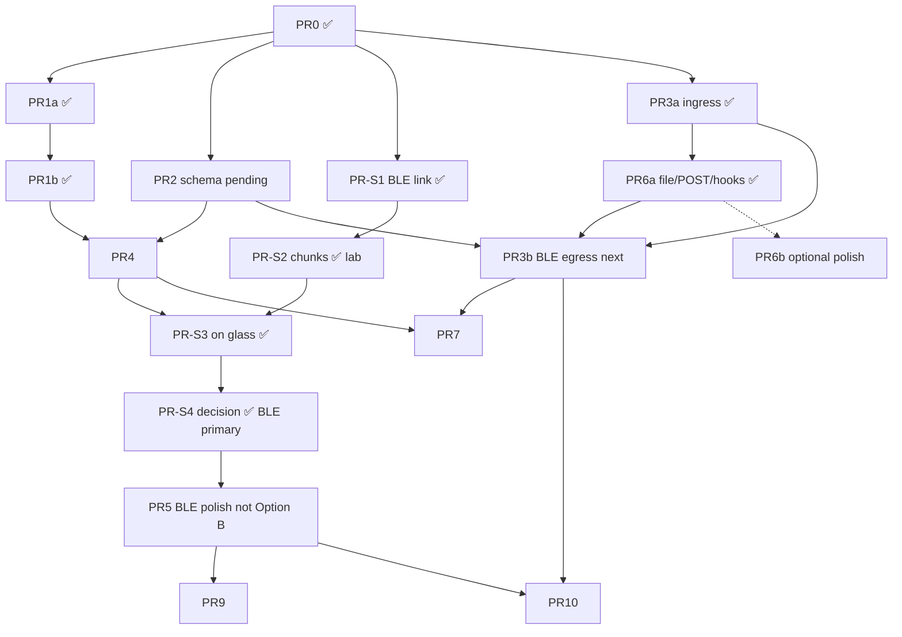

# PR Plan / Tickets

Each PR leaves the tree buildable. Stacked branches under `execute-plan/` (or merge to `main` as preferred).

Source design: [`docs/mvp-product-design.md`](../mvp-product-design.md).

**Progress (rev 2.9):** **PR0**, **PR1a**, **PR1b**, **PR-S1…PR-S4** (BLE **closed**). **PR3a** + **PR6a** (ingress). **PR2** schema package ✅, **PR3b** BLE egress ✅ (`acd-bridge push-ble`), **PR10** quickstart ✅, design-D UI (7 rows). **Still open:** PR5 polish, PR7 USB, PR6b optional. Do **not** invest in host-listen WiFi pull as product default.

---

## PR0 — Initialize repository and baseline monorepo hygiene ✅ Done

- **Status:** **Done** (2026-07-20)
- **Title:** `chore: git init, root gitignore, baseline commit of hello-world deck`
- **Files/components:** `.gitignore` (root), light `README.md`, existing `deck/**`
- **Depends on:** —
- **Description:** Create git repo; ignore `.pio/`, `secrets.h`, Python venvs, `.DS_Store`. Capture hello-world as known-good flashable baseline.

## PR1a — Firmware: display module extraction ✅ Done

- **Status:** **Done** (2026-07-20)
- **Title:** `refactor(deck): extract display power/present helpers from hello-world`
- **Files/components:** `deck/src/main.cpp`, `deck/src/display.cpp` / `.h`
- **Depends on:** PR0
- **Description:** Move `epd_init` / framebuffer alloc / poweron-clear-draw-poweroff into `display_*` without changing visual output (still hello-world strings). Small, reviewable.

## PR1b — Firmware: status layout + hardcoded demo DeckView ✅ Done

- **Status:** **Done** (2026-07-20)
- **Title:** `feat(deck): multi-session status layout with ASCII demo fixture`
- **Files/components:** `deck/src/ui_layout.cpp`, `deck/src/status_model.h` (C structs only), `main.cpp`, `deck/README.md`
- **Depends on:** PR1a
- **Description:** Draw header + **3** rows + footer from a compile-time `DeckView`. ASCII tokens `* o ! v`; progress via `epd_fill_rect`. No JSON/radio.

## PR2 — Schema package: JSON Schema + shared examples ✅ Done

- **Status:** **Done** (2026-07-21) — `display_limit=7` (design D), optional `state_counts`
- **Title:** `docs(schema): add StatusSnapshot v1 JSON Schema and examples`
- **Files/components:** `schema/status.schema.json`, `schema/examples/*.json`, `docs/status-schema.md`, root `README.md`
- **Depends on:** PR0 (parallel); can land before or with PR3b
- **Description:** Freeze field dictionary, sort order, **`display_limit=7`**, optional `sessions_total` + `state_counts`, 8 KiB budget. Align with bridge pydantic and deck `status_parse`.

## PR-S1 — Spike: BLE link only ✅ Done

- **Status:** **Done** (2026-07-20) — branch `spike/pr-s1-ble-link`
- **Title:** `spike(deck): NimBLE peripheral advertise + connect + notify heartbeat`
- **Files/components:** `deck/src/ble_gatt.*`, `deck/src/main.cpp`, `deck/platformio.ini` (NimBLE), `tools/ble_link/connect_soak.py`, `docs/ble-spike.md`, READMEs
- **Depends on:** PR0 (can parallel PR1*)
- **Description:** Deck advertises `ACD-*`; accepts one central; HEARTBEAT notify + INFO read. **Wi‑Fi off.** Host: minimal `bleak` connect/soak script. Fixed service UUIDs for S2 reuse.
- **Acceptance:** Connected **≥ 30 min**; reconnect after host BT toggle; heap logged; no WDT. **Met in lab.**

## PR-S2 — Spike: chunked bulk transfer ✅ Lab pass

- **Status:** **Lab pass** (2026-07-20) — branch `spike/pr-s2-s4-ble-end-to-end`; **100/100** host STATE `ok`; walk-around during soak
- **Title:** `spike: chunked 8KiB StatusSnapshot transfer over BLE`
- **Files/components:** `deck/src/ble_gatt.*` CTRL/DATA/STATE + CRC; `tools/ble_link/push_xfer.py`, `protocol.py`, payloads
- **Depends on:** PR-S1
- **Description:** Binary BEGIN/DATA/COMMIT; 8 KiB PSRAM reassembly; STATE notify; host chunk pusher. Double-buffer + conservative chunks for reliability.
- **Acceptance:** **100/100** clean transfers; record MTU and duration. **Met in lab** (incl. in-house movement).

## PR-S3 — Spike: on-glass mock status ✅ Closed (code + decision)

- **Status:** **Closed** (2026-07-20) — parse → `DeckView` → present in tree; optional glass smoke
- **Title:** `spike(deck): BLE snapshot → e-paper status layout`
- **Files/components:** `deck/src/status_parse.*`, `main.cpp`, ArduinoJson; host `mock_bridge.py`
- **Depends on:** PR-S2; PR1b
- **Description:** Reassembled JSON → `DeckView` → draw. SCHEMA fault path for bad version.
- **Acceptance:** Mock 3 sessions on glass; host payload change → redraw. **Code complete;** confirm on glass anytime.

## PR-S4 — Spike: bridge-shaped push + STALE ✅ Closed (decision locked)

- **Status:** **Closed** (2026-07-20) — decision matrix filled; BLE primary
- **Title:** `spike(bridge): mock/file → bleak push; STALE on disconnect`
- **Files/components:** `tools/ble_link/mock_bridge.py`; deck fail_count + 30 s STALE grace in `main.cpp`
- **Depends on:** PR-S3
- **Description:** Product-shaped loop: update sessions → push; kill pusher → STALE; restart → recovery.
- **Acceptance:** Decision: **BLE primary**, USB desk, Option B deferred. Optional STALE kill smoke remains a nice check.

## PR3a — Bridge core ingress: model, store, mock, localhost API ✅ Spike landed

- **Status:** **Done** (spike, 2026-07-20) — package under `bridge/`; **no deck egress**
- **Title:** `feat(bridge): Python status model, mock adapter, loopback serve`
- **Files/components:** `bridge/src/agent_control_deck_bridge/{model,store,server,main}.py`, `adapters/mock.py`, tests, `bridge/README.md`
- **Depends on:** Originally PR2; **spike proceeded without formal schema package** (pydantic only — see caveats)
- **Description:** Pydantic model, per-adapter replace semantics, mock adapter, truncate to 3 + `sessions_total`. **Localhost** HTTP for hooks/tools — **not** the firewalled “serve the deck” path. CLI: `acd-bridge serve`.
- **Caveats:** No `ble_out` / push loop; default `--log-hooks` logs bodies (spike); Grok uses command+curl not `type:http`.

## PR3b — Bridge BLE egress (promote ble_link) ✅ Done

- **Status:** **Done** (2026-07-21)
- **Title:** `feat(bridge): bleak push of store snapshot to deck`
- **Files/components:** `ble_protocol.py`, `ble_device.py`, `ble_out.py`, CLI `push-ble` (`--from-url` or `--adapter`), docs
- **Depends on:** PR3a; deck BLE path (PR-S* closed); ideally PR2
- **Description:** Poll `GET /v1/status` (or local adapters) → chunked GATT write. Kill pusher → deck STALE; restart → recovery. `tools/ble_link/*` remains for soak/lab.
- **Acceptance:** Mock and/or file/post sessions appear on glass via `acd-bridge push-ble` without hand-editing `mock_3sessions.json`.

## PR4 — Firmware: ArduinoJson v7 parse path + embedded fixture

- **Title:** `feat(deck): parse StatusSnapshot JSON into DeckView (ArduinoJson ^7)`
- **Files/components:** `deck/platformio.ini` (`bblanchon/ArduinoJson@^7.4.2`), `status_model.cpp`, `main.cpp`
- **Depends on:** PR1b, PR2
- **Description:** Shared by BLE spike S3 and USB. Schema mismatch → SCHEMA frame; no `fail_count++` on pure schema mismatch.

## PR5 — (Deferred / conditional) WiFi paths

- **Title:** *Either* production BLE polish *or* Option B LAN reverse-push *or* lab-only device-pull
- **Depends on:** **PR-S4 decision matrix**
- **Description:** **Do not implement host-listen device-pull as product default.** If BLE wins: harden pairing, reconnect, docs. If BLE fails range: Option B (deck listen + host outbound POST). Host-listen pull only as explicit lab exception.

## PR6a — Bridge: file adapter + loopback Session API + vendor hooks ✅ Spike landed

- **Status:** **Done** (spike, 2026-07-20) — ingress only
- **Title:** `feat(bridge): file adapter, loopback POST sessions, Grok/Claude hook mappers`
- **Files/components:** `adapters/file_adapter.py`, `post_adapter.py`, `server.py` routes, `hooks.py`, `examples/hooks/*`, peer checks, tests, README
- **Depends on:** PR3a
- **Description:** Supported integration into the bridge **without scrapers**. File mtime reload; `POST /v1/sessions` upsert; `PUT /v1/adapters/post` replace; `DELETE /v1/sessions/{id}`. Vendor lifecycle → `POST /v1/hooks/{grok,claude}` (shared mapper). Documented expected uses in `bridge/README.md`.
- **Caveats:** Does not push to deck (PR3b). Grok cannot use plain-HTTP `type:http` hooks — examples use command hooks. Formal Session examples still belong in PR2 `schema/examples/`.

## PR6b — (optional) Hook / adapter polish

- **Status:** **Optional / as needed**
- **Title:** `chore(bridge): production defaults for hook logging; more agent examples`
- **Depends on:** PR6a
- **Description:** Flip default `--log-hooks` off or redact; expand field coverage for real Grok/Claude payloads after lab soaks; any extra shell/file recipes. Not required for MVP-done if PR3b works with current mappers.

## PR7 — Firmware + bridge: USB serial exclusive transport

- **Title:** `feat: USB NDJSON status transport (exclusive mode)`
- **Files/components:** `deck/src/protocol_usb.cpp`, flags, `bridge/serial_out.py`, docs
- **Depends on:** PR4, PR3a
- **Description:** Exclusive with radio modes. Ignore non-`{` lines; 8 KiB line cap; same fail_count policy.

## PR8 — Bridge: experimental agent scraper

- **Title:** *Deferred* — not planned
- **Description:** Product choice: file/POST hooks only until revisited.

## PR9 — Firmware: power polish + optional battery

- **Title:** `feat(deck): light-sleep option; battery ADC behind ACD_BATTERY_UI`
- **Files/components:** `power.cpp`, battery read with `epd_poweron` first, UI footer
- **Depends on:** Stable radio path post-spike
- **Description:** Battery: poweron → delay → ADC → poweroff; default UI off.

## PR10 — Docs & demo polish: quickstart ✅ Done

- **Status:** **Done** (2026-07-21)
- **Title:** `docs: MVP quickstart (flash deck + push mock status)`
- **Files/components:** root `README.md`, bridge/deck READMEs, troubleshooting (BLE pair, STALE)
- **Depends on:** Winning transport from PR-S4 + **PR3b** (end-to-end bridge push)
- **Description:** 10-minute path: flash → serve → push-ble. Control out of scope. Hook notes in bridge README.

---

## Suggested merge order

**Near-term “BLE spike done” definition:** **Met** — PR-S1…S4 closed; decision in [`docs/ble-spike.md`](../ble-spike.md).

**Near-term “bridge ingress spike done” definition:** **Met** — PR3a + PR6a under `bridge/` (store + loopback HTTP + file/hooks). **Not** full product pipe (no PR3b egress, no PR2 schema freeze).

**MVP “done” definition (post-decision):** Layout ✅ + schema (PR2) + bridge model ✅ + **BLE push from bridge store** (PR3b) showing mock/file/hook sessions on glass with STALE behavior + quickstart. USB desk path as supported desk mode. Scrapers not required. Option B only if BLE fails in the field.

**Suggested next PRs:** **PR3b** (store → bleak push) and/or **PR2** (schema package) in parallel → PR5 polish → PR10 quickstart → PR7 USB when needed.
